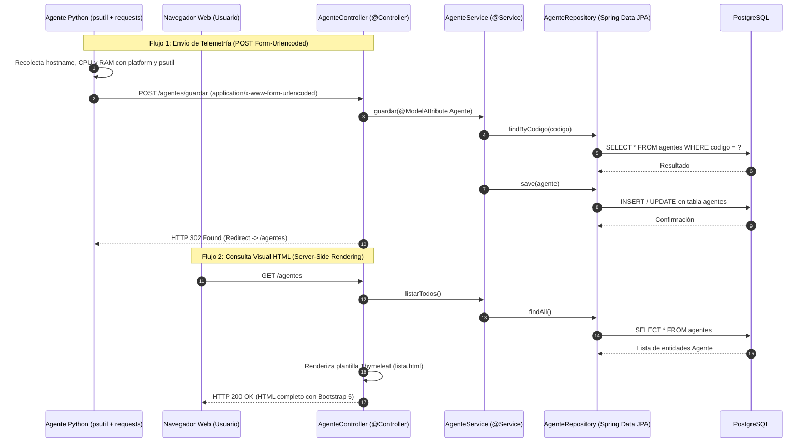

# Sistema de Auditoría de Endpoints — Fase 1 (Arquitectura Monolítica Síncrona)

> El proyecto incluye ahora **Auditoría web en vivo**, con autenticación obligatoria. Consulta [la guía actualizada de ejecución, seguridad y código](docs/LIVE_AUDIT.md) antes de seguir los pasos históricos de Fase 1.

Este documento describe en detalle la arquitectura, decisiones de diseño y componentes implementados en la **Fase 1** del Sistema de Auditoría de Endpoints. El objetivo de esta fase es demostrar el funcionamiento de un **monolito tradicional síncrono/bloqueante** en **Spring Boot (MVC + Thymeleaf + JPA)** interactuando con un **Agente de Telemetría en Python** mediante peticiones `application/x-www-form-urlencoded` (sin hacer uso de `@RestController` ni JSON).

---

## 1. Arquitectura General y Flujo de Datos

En esta primera fase, toda la comunicación sigue el modelo **petición-respuesta bloqueante (Thread-per-Request)** propio de Spring Web MVC sobre Tomcat embebido y JDBC síncrono:



---

## 2. Estructura del Proyecto

```text
ElLich/
├── pom.xml                                                # Dependencias Maven y configuración de Spring Boot 3
├── README.md                                              # Documentación arquitectónica y guía de uso
├── cliente_python/
│   ├── agente_telemetria.py                               # Script cliente de telemetría (psutil, platform, requests)
│   └── requirements.txt                                   # Librerías requeridas para Python
└── src/
    └── main/
        ├── java/org/example/
        │   ├── Main.java                                  # Punto de entrada @SpringBootApplication
        │   ├── controller/
        │   │   └── AgenteController.java                  # Controlador MVC tradicional (@Controller)
        │   ├── entity/
        │   │   └── Agente.java                            # Entidad JPA mapeada a la tabla "agentes"
        │   ├── repository/
        │   │   └── AgenteRepository.java                  # Repositorio Spring Data JPA
        │   └── service/
        │       └── AgenteService.java                     # Lógica de negocio y persistencia transaccional
        └── resources/
            ├── application.properties                     # Configuración de PostgreSQL por variables de entorno
            └── templates/
                └── lista.html                             # Vista HTML renderizada en servidor con Thymeleaf y Bootstrap
```

---

## 3. Detalle de lo Implementado

### 3.1. Configuración Maven (`pom.xml`)
Se transformó el proyecto base en una aplicación **Spring Boot 3.4.3** agregando los siguientes *starters*:
- **`spring-boot-starter-web`**: Provee el contenedor de servlets Tomcat embebido y la infraestructura Spring MVC síncrona.
- **`spring-boot-starter-thymeleaf`**: Motor de plantillas del lado del servidor (SSR) para devolver vistas HTML desde los controladores.
- **`spring-boot-starter-data-jpa`**: Abstracción de persistencia basada en Hibernate y JDBC bloqueante.
- **`postgresql`**: Driver JDBC oficial para conectarse a PostgreSQL.

### 3.2. Configuración de Entorno (`src/main/resources/application.properties`)
Se configuró la conexión a PostgreSQL inyectando las variables de entorno solicitadas (`DB_HOST`, `DB_PORT`, `DB_NAME`, `DB_USER`, `DB_PASSWORD`), incluyendo valores por defecto de respaldo (`:localhost`, `:5432`, etc.) para facilitar las pruebas locales:
- `spring.datasource.url=jdbc:postgresql://${DB_HOST:localhost}:${DB_PORT:5432}/${DB_NAME:auditoria_db}`
- `spring.datasource.username=${DB_USER:postgres}`
- `spring.datasource.password=${DB_PASSWORD:postgres}`
- `spring.jpa.hibernate.ddl-auto=update`: Permite que Hibernate cree o actualice automáticamente el esquema de la tabla `agentes` al iniciar la aplicación.

### 3.3. Capa de Datos (`entity` y `repository`)
1. **Entidad `Agente` (`org.example.entity.Agente`)**:
   - Mapeada a la tabla `agentes` mediante `@Entity` y `@Table(name = "agentes")`.
   - Atributos implementados:
     - `id` (`Long`): Clave primaria autoincremental (`GenerationType.IDENTITY`).
     - `codigo` (`String`): Identificador único del endpoint con restricción `@Column(nullable = false, unique = true)`.
     - `hostname` (`String`): Nombre de red de la máquina auditada.
     - `consumoMemoriaMb` (`Double`): Memoria RAM utilizada en Megabytes.
     - `activo` (`Boolean`): Estado operativo del agente.
2. **Repositorio `AgenteRepository` (`org.example.repository.AgenteRepository`)**:
   - Extiende `JpaRepository<Agente, Long>` para heredar las operaciones CRUD síncronas.
   - Define el método derivado `Optional<Agente> findByCodigo(String codigo)` para buscar agentes existentes por su código único.

### 3.4. Capa de Servicio (`org.example.service.AgenteService`)
Encapsula la lógica transaccional (`@Transactional`):
- **`listarTodos()`**: Recupera todos los registros de la base de datos de forma bloqueante.
- **`guardar(Agente agenteRecibido)`**: Implementa una lógica de **Upsert (Insertar o Actualizar)**. Antes de insertar, verifica con `findByCodigo()` si el endpoint ya reportó telemetría anteriormente:
  - Si ya existe, actualiza `hostname`, `consumoMemoriaMb` y `activo` sobre el registro existente. Esto evita que la segunda ejecución del script de Python falle por violación de la restricción `UNIQUE` en la columna `codigo`.
  - Si no existe, inserta un nuevo registro en PostgreSQL.

### 3.5. Capa de Controlador y Vista (`controller` y `templates`)
1. **`AgenteController` (`org.example.controller.AgenteController`)**:
   - Anotado estrictamente con `@Controller` (cumpliendo la restricción de **no usar `@RestController`**).
   - **`GET /agentes`**: Consulta la lista de agentes mediante `AgenteService`, la inyecta en el objeto `Model` de Spring y retorna el nombre lógico de la vista `"lista"` (`lista.html`).
   - **`POST /agentes/guardar`**: Consume datos en formato `application/x-www-form-urlencoded` y utiliza `@ModelAttribute Agente agente` para enlazar automáticamente los campos del formulario (o del diccionario enviado por Python) con las propiedades de la entidad Java. Al finalizar el guardado, retorna `"redirect:/agentes"` aplicando el patrón *Post/Redirect/Get (PRG)*.
2. **Vista `lista.html` (`src/main/resources/templates/lista.html`)**:
   - Construida con **Thymeleaf** y estilizada con **Bootstrap 5**.
   - Incluye un formulario HTML tradicional (`method="post" th:action="@{/agentes/guardar}"`) para pruebas manuales desde el navegador y una tabla responsiva que lista todos los agentes registrados con formato numérico de memoria y etiquetas de estado (*Activo* / *Inactivo*).

### 3.6. Cliente de Telemetría en Python (`cliente_python/agente_telemetria.py`)
Actúa como el agente instalado en el endpoint a auditar:
1. **Recolección legítima de métricas del sistema**:
   - Usa `platform.node()` y `platform.system()` para obtener el `hostname` real y el sistema operativo.
   - Usa `psutil.cpu_percent(interval=1.0)` para medir el porcentaje de uso de CPU.
   - Usa `psutil.virtual_memory()` para calcular tanto la RAM consumida (`consumoMemoriaMb`) como la RAM disponible (`ramDisponibleMb`) convertidas de bytes a Megabytes.
   - Genera un `codigo` único determinista por máquina (`AGT-<HASH>`) a partir del `hostname`.
2. **Empaquetado y envío por Form-Data (`application/x-www-form-urlencoded`)**:
   - Construye un diccionario plano cuyas claves (`codigo`, `hostname`, `consumoMemoriaMb`, `activo`) coinciden exactamente con los atributos de la entidad `Agente` en Java.
   - Realiza la petición `requests.post("http://localhost:8080/agentes/guardar", data=payload, timeout=10)`. Al pasar el diccionario al parámetro `data=`, la librería `requests` codifica el cuerpo como formulario HTML estándar, permitiendo que Spring Boot lo procese con `@ModelAttribute` igual que si proviniera de un navegador web.
3. **Manejo de Errores Resiliente (`try-except`)**:
   - Captura específicamente `requests.exceptions.ConnectionError` (cuando el servidor Spring Boot está apagado o inalcanzable), `requests.exceptions.Timeout` (cuando el hilo bloqueante del servidor tarda más de lo esperado) y `requests.exceptions.RequestException`.

---

## 4. Guía de Ejecución Paso a Paso

### Paso 1: Preparar la Base de Datos PostgreSQL
Asegúrate de tener una base de datos creada en PostgreSQL (por defecto `auditoria_db`) y configura las variables de entorno antes de iniciar el backend:

```powershell
$env:DB_HOST="localhost"
$env:DB_PORT="5432"
$env:DB_NAME="auditoria_db"
$env:DB_USER="postgres"
$env:DB_PASSWORD="tu_password"
```

### Paso 2: Iniciar el Backend Spring Boot
Puedes ejecutar la clase `org.example.Main` directamente desde **IntelliJ IDEA** o mediante Maven. Una vez iniciado, el servidor escuchará en `http://localhost:8080`.

### Paso 3: Ejecutar el Agente de Telemetría en Python
En una terminal dentro de la raíz del proyecto:

```powershell
pip install -r cliente_python/requirements.txt
python cliente_python/agente_telemetria.py
```

*Nota: Si ejecutas el script con el servidor Spring Boot apagado, podrás comprobar el bloque `try-except` mostrando el mensaje controlado de `[ERROR DE CONEXIÓN]` sin que el programa termine abruptamente con una traza no controlada.*

### Paso 4: Verificar los Resultados en la Interfaz Web
Abre tu navegador en:
- `http://localhost:8080/agentes`

Verás la tabla Bootstrap actualizada con las métricas reales enviadas por el script de Python, además de poder registrar o actualizar agentes manualmente desde el formulario superior.
